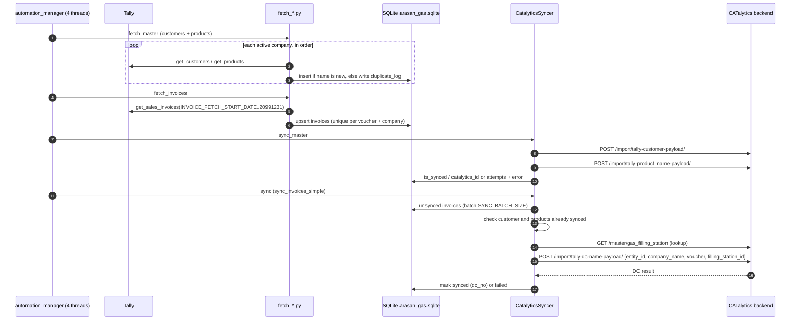

# arasan_gas (Arasan Gas)

## Purpose

Multi-company Tally-to-CATalytics sync for the Arasan Gas entity (`ENTITY_NAME` default `arasan_gas`, `ENTITY_ID` default `25`). It was built from `../ARASAN_GAS_MIDDLEWARE_PLAN.md`: the client keeps up to 4 Tally companies that share the same customers and stock, so masters are deduplicated **by name, first-come-first-served**, while invoices stay unique per `(voucher_no, company)`.

The code differs from the plan in places. The plan's `sync_customers.py`, `sync_products.py`, `sync_invoices_to_dc.py` and `web_ui.py` were never created; their work lives in `sync_to_catalytics.py` and `dashboard.py`.

## Data sources and targets

| Direction | What | Detail |
|-----------|------|--------|
| Source | Tally XML API at `TALLY_URL` | `TALLY_COMPANY_1..4`, `TALLY_COMPANY_ACTIVE` |
| Customers | Ledgers in `CUSTOMER_LEDGER_GROUPS` (default `Sundry Debtors`) | Name dedup; skips recorded in `duplicate_log` |
| Products | Stock items, name parsed into master/variant/type | Name dedup (`name_canonical` migration) |
| Invoices | Sales invoices from `INVOICE_FETCH_START_DATE` (or today) up to `20991231` | Kept only when "Other Reference" is `dc` or contains delivery / dispatch / pickup / self |
| Target | CATalytics backend `CATALYTICS_API_BASE` | `/import/tally-customer-payload/`, `/import/tally-product_name-payload/`, `/import/tally-dc-name-payload/` (automation thread and dashboard "Sync Invoices" trigger), `/import/tally-delivery-challan-payload/` (dashboard bulk retry, per-invoice resync, `/api/sync/now`). See [INTEGRATIONS.md](INTEGRATIONS.md) |
| Target (optional) | Backend PostgreSQL (`POSTGRES_*`) | Fallback `UPDATE` of DC `fill_station`; DC verification by number |

## Module breakdown

| Module | Role |
|--------|------|
| `config.py` | `Config` from `.env`. `SQLITE_DB_PATH` default `arasan_gas.sqlite`, `LOG_FILE` default `logs/arasan_gas.log`, both under `BASE_DIR` |
| `tally_client.py` | XML client with lock + cooldown. `get_customers` honours `CUSTOMER_LEDGER_GROUPS` |
| `db.py` | SQLite: `customers`, `products`, `invoices`, `sync_status`, `duplicate_log`. `get_unsynced_invoices(limit=50, max_attempts=10)` |
| `fetch_customers.py`, `fetch_products.py` | Per-company fetch with name dedup |
| `fetch_invoices.py` | Invoice fetch, delivery filter, `payload_hash` change detection, soft delete |
| `sync_to_catalytics.py` | `CatalyticsSyncer`: `sync_customers`, `sync_products`, `sync_invoices_simple` (automation + "Sync Invoices" button), `sync_invoices_to_dc` (full payload to `/import/tally-delivery-challan-payload/` with `VERIFY_AFTER_SYNC` DC verification; used by dashboard retry/resync/sync-now). Two DC paths exist side by side |
| `verify_sync.py`, `data_matcher.py` | Backend checks (Bearer token + `Entity-Id` header) and dashboard data match |
| `automation_manager.py` | 4 threads (see Sync schedule) |
| `dashboard.py`, `templates/dashboard.html`, `log_capture.py` | Flask dashboard (same routes as BHOX/BOL) |
| `check_customers.py`, `check_pending_invoices.py`, `debug_invoice_fetch.py`, `diagnose_invoice.py`, `diagnose_specific_invoice.py`, `reset_failed_invoices.py`, `verify_sync.py`, `view_customer_sync_errors.py`, `tmp_patch_items_vehicle.py`, `migrations/add_canonical_name.py` | Diagnostics and maintenance |

## Data flow

## Sync schedule

Four independent threads, each skipping a cycle while the global operation lock is held:

| Thread | Interval (default) | Work |
|--------|--------------------|------|
| `fetch_master` | `FETCH_MASTER_INTERVAL_MINUTES` (10 min) | Fetch customers + products |
| `fetch_invoices` | `FETCH_INVOICES_INTERVAL_MINUTES` (10 min) | Fetch invoices |
| `sync_master` | `SYNC_MASTER_INTERVAL_MINUTES` (5 min) | `sync_customers` + `sync_products` |
| `sync` | `SYNC_INVOICES_INTERVAL_SECONDS` (30 s) | `sync_invoices_simple` |

Live intervals are saved in `automation_state.json`. The checked-in copy shows `fetch_master` 600 s and `fetch_invoices` / `sync` 30 s, so the persisted state overrides the env defaults once it exists (inferred from `_load_state`).

## Local storage

| Table | Notes |
|-------|-------|
| `customers` | `tally_guid`, unique `name`, `tally_company` (owner), GST/PAN/address, sync columns (`is_synced`, `catalytics_id`, `sync_attempts`, `last_sync_error`) |
| `products` | `tally_guid`, `name`, `name_canonical`, `tally_company`, HSN/unit/rate, parsed type, sync columns |
| `invoices` | `tally_voucher_no` + `tally_company`, `voucher_date`, `customer_name`, items JSON, `payload_hash`, `dc_no`, `catalytics_dc_id`, sync columns |
| `sync_status` | Operation run log (processed / success / failed / skipped) |
| `duplicate_log` | `entity_type`, `entity_name`, `tally_company`, `owned_by_company` |

## Dashboard

Flask `dashboard.py`, title "Arasan Gas Middleware Dashboard", `WEB_UI_HOST` (default `localhost`):`WEB_UI_PORT` (8787). Its route set and panels are the same as [BHOX_MIDDLEWARE.md](BHOX_MIDDLEWARE.md#dashboard). The "Duplicates" panel matters most here because of name-based dedup.

## Config (names only)

| Group | Variables |
|-------|-----------|
| Entity | `ENTITY_NAME`, `ENTITY_ID`, `DEFAULT_FILLING_STATION`, `DEFAULT_FILLING_STATION_ID` |
| Backend | `CATALYTICS_API_BASE`, `CATALYTICS_API_KEY` |
| Tally | `TALLY_URL`, `TALLY_COMPANY_1..4`, `TALLY_COMPANY_ACTIVE`, `TALLY_REQUEST_COOLDOWN`, `CUSTOMER_LEDGER_GROUPS` |
| Rules | `PRODUCT_TYPE_MAP`, `INVOICE_FETCH_START_DATE` |
| Schedule | `FETCH_MASTER_INTERVAL_MINUTES`, `FETCH_CUSTOMERS_INTERVAL_MINUTES`, `FETCH_PRODUCTS_INTERVAL_MINUTES`, `FETCH_INVOICES_INTERVAL_MINUTES`, `SYNC_INTERVAL_SECONDS`, `SYNC_INVOICES_INTERVAL_SECONDS`, `SYNC_MASTER_INTERVAL_MINUTES`, `SYNC_BATCH_SIZE`, `CUSTOMER_SYNC_WORKERS`, `RUN_DAILY_AUDIT`, `AUDIT_TIME` |
| Verify | `VERIFY_AFTER_SYNC`, `VERIFY_RETRY_COUNT`, `VERIFY_RETRY_DELAY_SECONDS`, `VERIFY_TIMEOUT_SECONDS` |
| Storage | `SQLITE_DB_PATH`, `POSTGRES_HOST`, `POSTGRES_PORT`, `POSTGRES_DB`, `POSTGRES_USER`, `POSTGRES_PASSWORD` |
| Logging | `LOG_LEVEL`, `LOG_FILE`, `LOG_MAX_BYTES`, `LOG_BACKUP_COUNT` |
| UI / startup | `WEB_UI_HOST`, `WEB_UI_PORT`, `AUTO_OPEN_DASHBOARD`, `AUTO_START_AUTOMATION`, `DASHBOARD_DEBUG`, `AUTO_REGISTER_WINDOWS_STARTUP`, `WINDOWS_STARTUP_APP_NAME` |

## Install, run, package

| Step | Command |
|------|---------|
| Install deps | `pip install -r requirements.txt` |
| Configure | copy `.env.example` to `.env` |
| Init DB | `python db.py` (creates `arasan_gas.sqlite`) |
| One-off runs | `python fetch_customers.py`, `fetch_products.py`, `fetch_invoices.py`, `sync_to_catalytics.py` |
| Dashboard (dev) | `python dashboard.py` |
| Build EXE | `build_exe.bat` / `BUILD_AND_DEPLOY.bat` -> PyInstaller onefile/noconsole `dist\arasan_gas_dashboard.exe` (spec `arasan_gas_dashboard.spec`) |
| Release zip | `build_release.bat` -> `release\arasan_gas_client_release_<stamp>.zip` |

Build outputs are present in the repo but were not inspected: `build/arasan_gas_dashboard/`, `dist/arasan_gas_dashboard.exe`, and `release/arasan_gas_client_release_20260228_1716.zip` (built 28-Feb-2026 per its name).

## Scripts

| Script | Purpose |
|--------|---------|
| `Start_Dashboard.bat` / `Stop_Dashboard.bat` | Start / kill `arasan_gas_dashboard.exe` |
| `Install_AutoStart.bat` / `Remove_AutoStart.bat` | HKCU Run value `ArasanGasMiddlewareDashboard` |
| `automation/install_task_scheduler.bat` | `schtasks` tasks `Arasan_Gas_Fetch_Master_Data` (10 min), `Arasan_Gas_Fetch_Invoices_1/_2`, `Arasan_Gas_Sync_To_Catalytics_1/_2` (every minute, offset 30 s) |
| `automation/start_all_services.bat`, `stop_all_services.bat`, `continuous_*.bat`, `monitor_status.bat`, `view_logs.bat`, `uninstall_task_scheduler.bat` | Loop-based alternative to the in-process threads |
| `BUILD_V1.2.0.bat`, `QUICK_BUILD.bat` | Versioned build wrapper |
