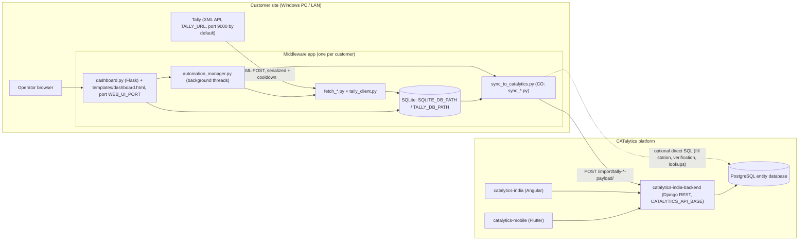

# Architecture

## Purpose

CATalytics customers (industrial gas fillers / distributors) do their accounting in **Tally**. Each middleware app runs on a Windows PC at the customer site. It:

1. Pulls masters (customers = ledgers, products = stock items) and transactions (delivery notes or sales invoices) from the local Tally instance over Tally's XML-over-HTTP interface.
2. Stores them in a local **SQLite** database with per-record sync state.
3. Pushes them to the **CATalytics backend** (Django, sibling repo `catalytics-india-backend`) through its `/import/...-payload/` endpoints, where each Tally voucher becomes a **Delivery Challan (DC)**.
4. Shows a local **Flask web dashboard** for monitoring, manual fetch/sync, retries and logs.

No scanners, RFID readers or ERPs other than Tally are read by any app. No code for those sources exists in this repo.

## Repository layout

| Folder | Customer | Notes |
|--------|----------|-------|
| `CO_middleware/` | Chennai Oxygen | Oldest code. Separate `sync_customers.py` / `sync_products.py` / `sync_catalytics.py` modules, plus a legacy `web_ui.py` UI and `run_loop*.py` CLI loops |
| `BHOX_Middleware/` | BHOX | Multi-company copy. Single `sync_to_catalytics.py` (`CatalyticsSyncer` class) |
| `arasan_gas/` | Arasan Gas | Multi-company copy. Only app with checked-in `build/`, `dist/` and a `release/` zip |
| `bol_company/` | BOL | Multi-company copy, with BOL-specific DC classification |

The three multi-company apps share nearly identical file sets, dashboards (same Flask routes) and `automation/` scripts. They differ in fetch/sync rules (see the per-app docs). Shared code is **copied, not imported**: there is no common package.

## High-level diagram

The frontend and mobile apps never talk to the middleware. They see the synced data through the backend (inferred: no middleware code references them).

## Common pattern (all four apps)

| Stage | What happens | Where |
|-------|--------------|-------|
| Tally access | XML envelopes POSTed to `TALLY_URL`. A process-wide `threading.Lock` serializes requests, and a sleep of `TALLY_REQUEST_COOLDOWN` seconds follows each one (CO guide: Tally crashes with memory-access violations under rapid requests) | `tally_client.py` (`send_request`) |
| Master fetch | Ledgers -> customers, stock items -> products. Stock-item names are parsed into product master + variant + type (cylinder / tank / pallet, `PRODUCT_TYPE_MAP`) | `fetch_customers.py`, `fetch_products.py` |
| Transaction fetch | Day Book / voucher collection fetched, then filtered **in Python** for DC-relevant vouchers. Missing customers/products are auto-fetched from Tally on the fly | `fetch_invoices.py` |
| Change detection | Full Tally JSON stored. `payload_hash` used to detect edits; edited records are reset to unsynced. Records that disappear from Tally are soft-deleted (`is_deleted`) | `db.py`, `fetch_invoices.py` |
| Sync | Unsynced rows -> JSON payload -> backend `/import/...` endpoint. Success sets `is_synced=1` and stores `catalytics_id` / `dc_no`. Failure increments `sync_attempts` and stores `last_sync_error` | `sync_to_catalytics.py` / CO `sync_*.py` |
| Dependency order | DCs are synced only when their customer and products are already synced (or get synced first) | `_validate_invoice_for_sync`, `_ensure_invoice_dependencies_synced` |
| Fill station | DC fill station resolved from voucher fields or `DEFAULT_FILLING_STATION(_ID)` and matched against backend `/master/gas_filling_station`. Can be patched onto the DC by API, or by direct PostgreSQL `UPDATE` as a fallback | sync modules |
| Automation | Daemon threads inside the dashboard process. Each task has a non-blocking lock, and a global operation lock stops fetch/sync from overlapping. State goes to `automation_state.json` | `automation_manager.py` |
| UI | Flask + Flask-CORS, a single Jinja page with vanilla JS polling `/api/*` every 2-10 s | `dashboard.py`, `templates/dashboard.html` |

## Tech stack

| Layer | Technology | Evidence |
|-------|-----------|----------|
| Language | Python 3 (Windows `py` launcher in scripts) | `*.bat` files |
| Web/dashboard | Flask 3.0.x, Flask-CORS 4.0.0, Werkzeug (`make_server` in CO `web_ui.py`) | `requirements.txt` |
| HTTP client | `requests` | `requirements.txt` |
| Config | `.env` read by `python-dotenv` or a custom loader (CO `config.load_env_file`) | `config.py` |
| Local DB | SQLite (`sqlite3`, WAL mode, cross-process `msvcrt` lock file `<db>.lock`) | `db.py` |
| Backend DB access | `psycopg2-binary` 2.9.9 (direct PostgreSQL reads/updates) | `requirements.txt`, sync modules |
| XML parsing | `xml.etree` / optional `lxml` 5.1.0 | `requirements.txt`, `tally_client.py` |
| Packaging | PyInstaller `--onefile --noconsole`, templates bundled with `--add-data` | `build_exe.bat`, `*.spec` |
| Scheduling | In-process threads (primary). Optional Windows Task Scheduler (`schtasks`) or `cmd` loops in `automation/` | `automation_manager.py`, `automation/*.bat` |
| Auto-start | `HKCU\Software\Microsoft\Windows\CurrentVersion\Run` registry value | `dashboard.py`, `Install_AutoStart.bat` |

No FastAPI or Django is used inside the middleware. Django is only the remote backend.

## Shared design decisions

- **Local-first queue.** SQLite is the outbox. A backend outage only grows the unsynced queue, and rows are retried on the next cycle.
- **Retry ceiling.** Invoices stop retrying after `max_attempts` (10 in the multi-company apps, `SYNC_MAX_ATTEMPTS` default 5 in CO). BHOX additionally resets attempts for *transient* errors (connection refused, timed out, etc.) at the start of each sync (`reset_transient_failed_invoices`). Dashboard "retry" and "mark unsynced" actions reset rows manually.
- **Multi-company dedup.** Up to four Tally companies per site (`TALLY_COMPANY_1..4`, `TALLY_COMPANY_ACTIVE`). Masters are deduplicated either by name, first-come-first-served (CO, Arasan; duplicates recorded in `duplicate_log`), or by Tally GUID create/update (BHOX, BOL; BHOX products fall back to the canonical name). All three multi-company `db.py` files still create `duplicate_log`.
- **Verification.** `verify_sync.py` (`SyncVerifier`) can confirm records through backend GET endpoints, or for DCs through direct SQL. It is driven by `VERIFY_AFTER_SYNC` / `VERIFY_RETRY_*`. In the code paths read, the syncer calls it only in Arasan's `sync_invoices_to_dc` (not the default automation path), so most "verified" counts rely on the API response (inferred from call sites).
- **Logging.** Plain `logging.FileHandler` files under `logs/` next to the script or EXE: one per operation (`customer_fetch.log`, `invoice_sync.log`, `dc_sync_errors.log` ...) plus `dashboard_operations.log`, which streams to the dashboard terminal. `LOG_MAX_BYTES` / `LOG_BACKUP_COUNT` are read in config, but no rotating handler was found, so logs grow unbounded (inferred).
- **Runtime paths.** When frozen (PyInstaller), `.env`, DB and `logs/` resolve next to the EXE (`sys.executable`). Templates load from `sys._MEIPASS`.

## Observations and risks

- Dashboards have no authentication, and CORS is open. They bind to `WEB_UI_HOST` (default `localhost` in the three multi-company apps; CO's generated default `.env` uses `0.0.0.0`, and CO ships `allow_firewall.bat`).
- CO's dashboard exposes `/api/env-config` (read/write `.env`) and `/api/service/control`, which runs shell commands taken from `<SERVICE>_<ACTION>_CMD` env vars (`TALLY_START_CMD`, etc.).
- Direct PostgreSQL writes (`UPDATE transaction.delivery_challan SET fill_station`) bypass the backend API.
- Large copy-paste duplication between the three multi-company apps. BHOX build scripts and auto-start names still say `bol_dashboard` / `BOLMiddlewareDashboard`.
- Release notes and `BUILD_V1.2.0.bat` refer to files not in the repo (`test_single_invoice_sync.py`, `DEPLOY_V1.2.0.md`, `fix_customer_table_name.py`; `check_pending_invoices.py` exists only in `arasan_gas/`).
