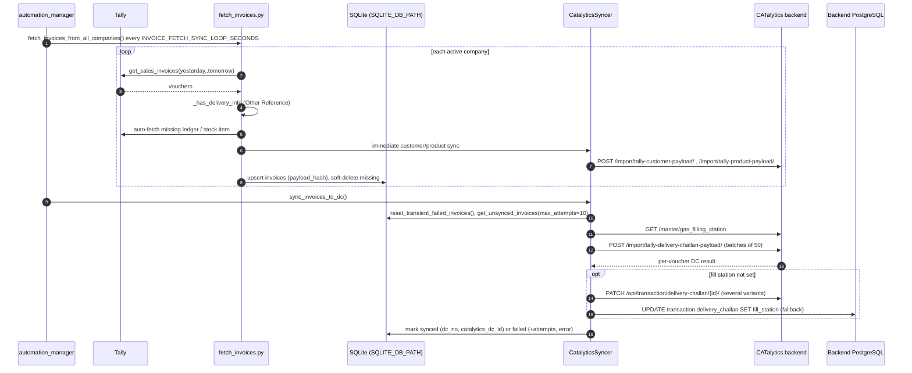

# BHOX_Middleware

## Purpose

Multi-company Tally-to-CATalytics sync for the "bhox" entity (`ENTITY_NAME` default `bhox`, `ENTITY_ID` default `25`). The README's example `TALLY_COMPANY_1` is a "Bharath Oxygen" company, so BHOX is probably Bharath Oxygen (inferred). It converts Tally **sales invoices** with delivery information into CATalytics Delivery Challans.

It shares its structure with `bol_company/` (same `config.py` style, same 2-thread automation, GUID batch sync). Several build and auto-start names still say "BOL" (see Scripts).

## Data sources and targets

| Direction | What | Detail |
|-----------|------|--------|
| Source | Tally XML API at `TALLY_URL` | Up to 4 companies: `TALLY_COMPANY_1..4`, enabled via `TALLY_COMPANY_ACTIVE` |
| Source data | Ledgers (all groups), stock items, sales invoices | Non-customer ledgers that look like products are turned into product variants (`_save_ledger_product_variants`) |
| DC filter | "Other Reference" (`BASICORDERREF`/`OTHERREFERENCE`) = `D`, `C`, delivery / dispatch / delivery challan / pickup / self pickup | Turned off with `REQUIRE_DELIVERY_REF=false` |
| Target | CATalytics backend `CATALYTICS_API_BASE` | `/import/tally-customer-payload/`, `/import/tally-product-payload/`, `/import/tally-delivery-challan-payload/`. See [INTEGRATIONS.md](INTEGRATIONS.md) |
| Target (optional) | Backend PostgreSQL (`POSTGRES_*`) | Fallback `UPDATE` of DC `fill_station`; `verify_sync.py` DC lookups |

## Module breakdown

| Module | Role |
|--------|------|
| `config.py` | `Config` class from `.env`. `BASE_DIR` is next to the EXE when frozen. `reload_from_env()` re-reads `.env` at every cycle |
| `tally_client.py` | XML client: `TallyClient.get_customers/get_products/get_sales_invoices`, lock + `TALLY_REQUEST_COOLDOWN` (default 2 s), `TALLY_TIMEOUT_LEDGER` / `TALLY_TIMEOUT_VOUCHER` |
| `db.py` | `Database` class: SQLite WAL, `msvcrt` write lock (`bhox.lock` / `bhox_oxygen.lock` seen in repo), retries on "database is locked", migrations |
| `fetch_customers.py` | All ledger groups. GUID-based create/update. Product-like ledgers saved as product variants |
| `fetch_products.py` | Stock items -> one row per variant (CO2 30 kg; liquid O2 200/230/247/250 L; liquid N2 200/250 L; pallet 105 cum; cylinder 7/10 cum) |
| `fetch_invoices.py` | Day Book fetch (yesterday to tomorrow by default; monthly batches for explicit ranges), delivery filter, `payload_hash` change detection, soft delete, auto-fetch and immediate sync of missing customers/products, `is_instant` flag |
| `sync_to_catalytics.py` | `CatalyticsSyncer`: `sync_customers` / `sync_products` (100 per call), `sync_invoices_to_dc` (50 per call), fill-station resolution, Instant DC code (disabled) |
| `verify_sync.py` | `SyncVerifier`: GET `/api/master/customer|product/{id}/`, `/api/transaction/delivery-challan/{id}/`, plus SQL `verify_dc_by_number` |
| `data_matcher.py` | Dashboard "Data Verification": SQLite vs backend comparison |
| `automation_manager.py` | 2 threads (see Sync schedule) |
| `dashboard.py`, `templates/dashboard.html`, `log_capture.py` | Flask dashboard + log streaming |
| `analyze_vouchers.py`, `check_tally.py`, `diagnose_*.py`, `view_customer_sync_errors.py`, `reset_failed_invoices.py`, `migrations/add_canonical_name.py` | Diagnostics and maintenance |

## Data flow

## Sync schedule

| Thread | Schedule | Work |
|--------|----------|------|
| `fetch_master` | Runs once at start, then daily at `MASTER_SYNC_TIME` (default `02:00`). On failure, retries after `MASTER_SYNC_FAILURE_RETRY_MINUTES` (30). On a loop error, waits `DAILY_MASTER_ERROR_WAIT_SECONDS` | Fetch customers -> fetch products -> sync customers -> sync products |
| `sync` | Every `INVOICE_FETCH_SYNC_LOOP_SECONDS` (default 20 s). On a loop error, waits `LOOP_ERROR_RECOVERY_SECONDS` | Fetch invoices -> `sync_invoices_to_dc` |

The older settings `FETCH_*_INTERVAL_MINUTES`, `SYNC_INVOICES_INTERVAL_SECONDS` and `SYNC_MASTER_INTERVAL_MINUTES` still feed `DEFAULT_INTERVALS` (shown in the UI), but the code comment says the separate loops were "merged into `_invoice_fetch_sync_loop`".

## Local storage

SQLite at `SQLITE_DB_PATH` (README: `bhox.sqlite`), resolved relative to `BASE_DIR`.

| Table | Key columns |
|-------|-------------|
| `customers` | `tally_guid` (unique), `name`, `tally_company`, GST/PAN/address, `data_json`, `sync_request_json`, `last_response_json`, `is_synced`, `catalytics_id`, `sync_attempts`, `last_sync_error` |
| `products` | `tally_guid`, `name`, `name_canonical`, product master / variant / unit / type, GST rates, sync columns |
| `invoices` | `tally_voucher_no`, `tally_company`, `tally_guid`, `voucher_date`, `customer_name`, items / ledger / stock JSON, `payload_hash`, `is_deleted`, `dc_no`, `catalytics_dc_id`, `is_instant`, sync columns |
| `sync_status` | Operation run log |
| `duplicate_log` | Skipped duplicates per company |

## Dashboard

Flask `dashboard.py` on `WEB_UI_HOST` (default `localhost`):`WEB_UI_PORT` (8787), title "BHOX Middleware Dashboard". Its panels and route set are the same as `arasan_gas` and `bol_company`:

- `/api/status`, `/api/progress`, `/api/activity`, `/api/errors`, `/api/operation`, `/api/duplicates`
- `/api/trigger/{fetch_customers,fetch_products,fetch_invoices,sync,sync_customers,sync_products,sync_invoices}`, `/api/fetch/now`, `/api/sync/now`
- `/api/data/{customers,products,invoices}`, `/api/{customers,products,invoices}/<id>/{detail,resync,refetch}`
- `/api/bulk/{retry,mark-unsynced}-{customers,products,invoices}`, `/api/database/clear`
- `/api/automation/{status,start,stop,restart,set-intervals}`
- `/api/logs`, `/api/logs/recent`, `/api/logs/clear`, `/api/diagnostics`, `/api/verify/data-match`, `/api/debug/products-tally`, `/api/test/version`

JS polls status, activity and errors every 5 s, tables every 10 s, and progress and automation status every 2 s.

## Config (names only)

| Group | Variables |
|-------|-----------|
| Entity | `ENTITY_NAME`, `ENTITY_ID`, `DEFAULT_ADMIN_USER_ID`, `DEFAULT_FILLING_STATION`, `DEFAULT_FILLING_STATION_ID` |
| Backend | `CATALYTICS_API_BASE`, `CATALYTICS_API_KEY`, `CATALYTICS_USE_AUTH` (`auto`/`true`/`false`), `API_TIMEOUT_INVOICE_SYNC`, `API_TIMEOUT_BATCH_SYNC`, `API_TIMEOUT_SHORT`, `CATALYTICS_CHECK_TIMEOUT` |
| Tally | `TALLY_URL`, `TALLY_COMPANY`, `TALLY_COMPANY_1..4`, `TALLY_COMPANY_ACTIVE`, `TALLY_REQUEST_COOLDOWN`, `TALLY_TIMEOUT_LEDGER`, `TALLY_TIMEOUT_VOUCHER`, `TALLY_CHECK_TIMEOUT`, `TALLY_DB_PATH` |
| Rules | `PRODUCT_TYPE_MAP`, `REQUIRE_DELIVERY_REF`, `INVOICE_FETCH_START_DATE` |
| Schedule | `MASTER_SYNC_TIME`, `MASTER_SYNC_FAILURE_RETRY_MINUTES`, `INVOICE_FETCH_SYNC_LOOP_SECONDS`, `INVOICE_BATCH_SLEEP_SECONDS`, `LOOP_ERROR_RECOVERY_SECONDS`, `DAILY_MASTER_ERROR_WAIT_SECONDS`, `AUTOMATION_RESTART_SLEEP_SECONDS`, `FETCH_MASTER_INTERVAL_MINUTES`, `FETCH_CUSTOMERS_INTERVAL_MINUTES`, `FETCH_PRODUCTS_INTERVAL_MINUTES`, `FETCH_INVOICES_INTERVAL_MINUTES`, `SYNC_INTERVAL_SECONDS`, `SYNC_INVOICES_INTERVAL_SECONDS`, `SYNC_MASTER_INTERVAL_MINUTES`, `CUSTOMER_SYNC_WORKERS`, `RUN_DAILY_AUDIT`, `AUDIT_TIME` |
| Verify | `VERIFY_AFTER_SYNC`, `VERIFY_RETRY_COUNT`, `VERIFY_RETRY_DELAY_SECONDS`, `VERIFY_TIMEOUT_SECONDS` |
| Storage | `SQLITE_DB_PATH`; PostgreSQL `POSTGRES_HOST`, `POSTGRES_PORT`, `POSTGRES_DB`, `POSTGRES_USER`, `POSTGRES_PASSWORD`, `POSTGRES_CONNECT_TIMEOUT` |
| Logging | `LOG_LEVEL`, `LOG_FILE` (default `logs/bhox.log`), `LOG_MAX_BYTES`, `LOG_BACKUP_COUNT` |
| UI / startup | `WEB_UI_HOST`, `WEB_UI_PORT`, `AUTO_OPEN_DASHBOARD`, `AUTO_START_AUTOMATION`, `DASHBOARD_DEBUG`, `AUTO_REGISTER_WINDOWS_STARTUP`, `WINDOWS_STARTUP_APP_NAME` |

## Install, run, package

| Step | Command |
|------|---------|
| Install deps | `pip install -r requirements.txt` |
| Configure | copy `.env.example` to `.env` |
| Init DB | `python db.py` |
| Test Tally | `python tally_client.py` / `python check_tally.py` |
| One-off runs | `python fetch_customers.py`, `fetch_products.py`, `fetch_invoices.py [YYYYMMDD YYYYMMDD]`, `sync_to_catalytics.py` |
| Dashboard (dev) | `python dashboard.py` |
| Headless automation | `python automation_manager.py` (standalone `__main__`, Ctrl+C to stop; BOL has the same) |
| Build EXE | `build_exe.bat` -> PyInstaller onefile/noconsole, **`dist\bol_dashboard.exe`** (spec `bhox_dashboard.spec` also names it `bol_dashboard`) |
| Release zip | `build_release.bat` -> `release\bol_client_release_<stamp>.zip` (EXE, `.env.example` copied as `.env`, `README_CLIENT_SETUP.txt`, start/auto-start scripts, `logs\`) |
| Versioned build | `BUILD_V1.2.0.bat` (via `QUICK_BUILD.bat`) calls `BUILD_AND_DEPLOY.bat`, then copies extra files that do not exist in this folder |

## Scripts

| Script | Purpose |
|--------|---------|
| `Start_Dashboard.bat` / `Stop_Dashboard.bat` | Start / `taskkill` `bol_dashboard.exe` |
| `Install_AutoStart.bat` / `Remove_AutoStart.bat` | HKCU Run value `BOLMiddlewareDashboard` |
| `automation/start_all_services.bat` | Checks Tally (`localhost:9000`) and backend (`localhost:8000`) with curl, then starts the `continuous_fetch_invoices.bat` and `continuous_sync.bat` loops (30 s) in minimized windows |
| `automation/install_task_scheduler.bat` | `schtasks` (admin): master data every 10 min, invoice fetch and sync twice a minute. Task names are prefixed `BOL_Gas_` (copied) |
| `automation/stop_all_services.bat`, `uninstall_task_scheduler.bat`, `monitor_status.bat`, `view_logs.bat`, `start_dashboard.bat` | Service helpers |

The `automation/` scripts are an alternative to the in-process threads. Running both at once would duplicate work (inferred).
