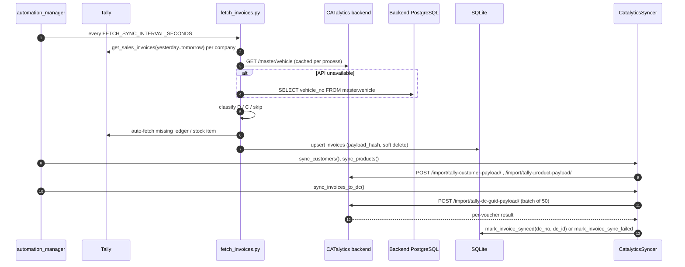

# bol_company (BOL)

## Purpose

Multi-company Tally-to-CATalytics sync for the "bol" entity (`ENTITY_NAME` default `bol`, `ENTITY_ID` default `25`). The code does not spell out "BOL" anywhere read. It converts Tally sales invoices into CATalytics Delivery Challans, using a **BOL-specific rule** to decide whether an invoice is a delivery (`D`) or a customer pickup (`C`), and sends DCs through the GUID-based endpoint.

## Data sources and targets

| Direction | What | Detail |
|-----------|------|--------|
| Source | Tally XML API at `TALLY_URL` | `TALLY_COMPANY_1..4`, `TALLY_COMPANY_ACTIVE` |
| Customers | Ledgers (all groups) | Tally GUID create/update |
| Products | Stock items; type by keyword: `pallet` -> PALLET, `liquid` -> TANK, otherwise CYLINDER | GUID create/update |
| Invoices | Sales invoices, Day Book window **always** yesterday to tomorrow | Classified by `_resolve_delivery_reference` (below) |
| Lookup | Backend vehicle master | `GET /master/vehicle` (anonymous; tries both with and without `/api`), falling back to SQL on `master.vehicle` |
| Target | CATalytics backend `CATALYTICS_API_BASE` | `/import/tally-customer-payload/`, `/import/tally-product-payload/`, `/import/tally-dc-guid-payload/`. See [INTEGRATIONS.md](INTEGRATIONS.md) |
| Target (optional) | Backend PostgreSQL (`POSTGRES_*`) | Vehicle fallback, fallback `UPDATE` of DC `fill_station`, `master.product_group` read (only by the inactive Instant DC matcher) |

### DC classification rule (`fetch_invoices._resolve_delivery_reference`)

1. "Other Reference" is exactly `C` or `D`: use it.
2. Vehicle number is `-`: `D` (delivery placeholder).
3. Vehicle number found in the backend vehicle master: `D`. Not found: `C` (customer pickup). Lookup unavailable: `C`.
4. No Other Reference and no vehicle: not a DC, so the invoice is skipped.

Vehicle numbers are read from `DISPATCHEDTHROUGH`, `BASICSHIPPEDBY`, `MOTORVEHICLENO`, `VEHICLENO` and similar voucher fields.

## Module breakdown

| Module | Role |
|--------|------|
| `config.py` | `Config` from `.env`. `SQLITE_DB_PATH` / `TALLY_DB_PATH` normalized (mirrors CO). `LOG_FILE` default `logs/bol.log` |
| `tally_client.py` | XML client with lock + cooldown |
| `db.py` | SQLite (same schema as BHOX), `msvcrt` lock files (`bol.lock`, `bol_oxygen.lock` present), `get_unsynced_invoices(max_attempts=10)` |
| `fetch_customers.py`, `fetch_products.py` | Per-company master fetch |
| `fetch_invoices.py` | Day Book fetch, vehicle-master classification, auto-fetch missing customers/products, `payload_hash`, soft delete, `is_instant` flag |
| `sync_to_catalytics.py` | `CatalyticsSyncer`: `sync_customers`, `sync_products` (100 per call), `sync_invoices_to_dc` (50 per call to `/import/tally-dc-guid-payload/`, timeout 180 s), `_ensure_invoice_dependencies_synced` (syncs a missing customer/product, then retries). Also holds an unused `sync_invoices_simple` + Instant DC matching path (`/import/tally-dc-name-payload/`) |
| `verify_sync.py`, `data_matcher.py` | Backend checks (`Entity-Id` header) and dashboard data match |
| `automation_manager.py` | 2 threads (see Sync schedule) |
| `dashboard.py`, `templates/dashboard.html`, `log_capture.py` | Flask dashboard |
| `analyze_vouchers.py`, `diagnose_customers.py`, `diagnose_stock_items.py`, `reset_failed_invoices.py`, `verify_sync.py`, `view_customer_sync_errors.py`, `migrations/add_canonical_name.py` | Diagnostics and maintenance |

## Data flow

## Sync schedule

| Thread | Schedule | Work |
|--------|----------|------|
| `fetch_master` | Runs once at start, then daily at `MASTER_SYNC_TIME` (default `02:00`). On failure, retries after `MASTER_SYNC_FAILURE_RETRY_MINUTES` | Fetch customers + products, then sync both |
| `sync` | Every `FETCH_SYNC_INTERVAL_SECONDS` (default 10 s) | Fetch invoices -> sync customers -> sync products -> `sync_invoices_to_dc` |

`DEFAULT_INTERVALS` shows `fetch_master` / `sync_master` as 86400 s (daily) in the UI. Runs that overlap are skipped, not queued.

## Local storage

SQLite at `SQLITE_DB_PATH` (README: `bol.sqlite`). Tables are the same as BHOX: `customers`, `products`, `invoices`, `sync_status`, `duplicate_log`. See [BHOX_MIDDLEWARE.md](BHOX_MIDDLEWARE.md#local-storage).

## Dashboard

Flask `dashboard.py`, title "BOL Middleware Dashboard", `WEB_UI_HOST` (default `localhost`):`WEB_UI_PORT` (8787). It has the same routes and panels as BHOX and Arasan; see [BHOX_MIDDLEWARE.md](BHOX_MIDDLEWARE.md#dashboard). Every invoice sync button calls `sync_invoices_to_dc`.

## Config (names only)

| Group | Variables |
|-------|-----------|
| Entity | `ENTITY_NAME`, `ENTITY_ID`, `DEFAULT_ADMIN_USER_ID`, `DEFAULT_FILLING_STATION`, `DEFAULT_FILLING_STATION_ID` |
| Backend | `CATALYTICS_API_BASE`, `CATALYTICS_API_KEY` (read but not sent on payload calls) |
| Tally | `TALLY_URL`, `TALLY_COMPANY`, `TALLY_COMPANY_1..4`, `TALLY_COMPANY_ACTIVE`, `TALLY_REQUEST_COOLDOWN`, `TALLY_DB_PATH` |
| Rules | `PRODUCT_TYPE_MAP`, `INVOICE_FETCH_START_DATE` (does not affect automation, which always uses yesterday to tomorrow) |
| Schedule | `FETCH_SYNC_INTERVAL_SECONDS`, `MASTER_SYNC_TIME`, `MASTER_SYNC_FAILURE_RETRY_MINUTES`, `FETCH_MASTER_INTERVAL_MINUTES`, `FETCH_CUSTOMERS_INTERVAL_MINUTES`, `FETCH_PRODUCTS_INTERVAL_MINUTES`, `FETCH_INVOICES_INTERVAL_MINUTES`, `SYNC_INTERVAL_SECONDS`, `SYNC_INVOICES_INTERVAL_SECONDS`, `SYNC_MASTER_INTERVAL_MINUTES`, `CUSTOMER_SYNC_WORKERS`, `RUN_DAILY_AUDIT`, `AUDIT_TIME` |
| Verify | `VERIFY_AFTER_SYNC`, `VERIFY_RETRY_COUNT`, `VERIFY_RETRY_DELAY_SECONDS`, `VERIFY_TIMEOUT_SECONDS` |
| Storage | `SQLITE_DB_PATH`, `POSTGRES_HOST`, `POSTGRES_PORT`, `POSTGRES_DB`, `POSTGRES_USER`, `POSTGRES_PASSWORD` |
| Logging | `LOG_LEVEL`, `LOG_FILE`, `LOG_MAX_BYTES`, `LOG_BACKUP_COUNT` |
| UI / startup | `WEB_UI_HOST`, `WEB_UI_PORT`, `AUTO_OPEN_DASHBOARD`, `AUTO_START_AUTOMATION`, `DASHBOARD_DEBUG`, `AUTO_REGISTER_WINDOWS_STARTUP`, `WINDOWS_STARTUP_APP_NAME` |

## Install, run, package

| Step | Command |
|------|---------|
| Install deps | `pip install -r requirements.txt` |
| Configure | copy `.env.example` to `.env` |
| Init DB | `python db.py` |
| One-off runs | `python fetch_customers.py`, `fetch_products.py`, `fetch_invoices.py`, `sync_to_catalytics.py` |
| Dashboard (dev) | `python dashboard.py` |
| Build EXE | `build_exe.bat` / `BUILD_AND_DEPLOY.bat` -> PyInstaller onefile/noconsole `dist\bol_dashboard.exe` (spec `bol_dashboard.spec`) |
| Release zip | `build_release.bat` -> `release\bol_client_release_<stamp>.zip` |

## Scripts

| Script | Purpose |
|--------|---------|
| `Start_Dashboard.bat` / `Stop_Dashboard.bat` | Start / kill `bol_dashboard.exe` |
| `Install_AutoStart.bat` / `Remove_AutoStart.bat` | HKCU Run value `BOLMiddlewareDashboard` |
| `automation/install_task_scheduler.bat` | `schtasks`: `BOL_Gas_Fetch_Master_Data` (10 min), `BOL_Gas_Fetch_Invoices_1/_2`, `BOL_Gas_Sync_To_Catalytics_1/_2` (every minute, offset 30 s) |
| `automation/start_all_services.bat`, `stop_all_services.bat`, `continuous_*.bat`, `monitor_status.bat`, `view_logs.bat`, `uninstall_task_scheduler.bat` | Loop-based alternative to the in-process threads |
| `BUILD_V1.2.0.bat`, `QUICK_BUILD.bat` | Versioned build wrapper. It copies helper files, some of which are missing from this folder |
