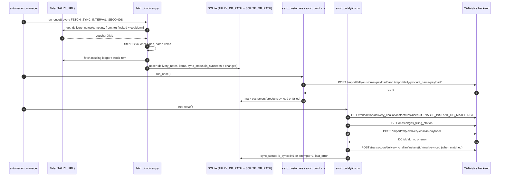

# CO_middleware (Chennai Oxygen)

## Purpose

Tally-to-CATalytics sync for the Chennai Oxygen entity (`ENTITY_NAME` default `Chennai Oxygen`, `ENTITY_ID` default `1`). It is the oldest of the four apps, and the others were modelled on it (`BHOX_Middleware` comments say "mirrors CO_middleware behaviour"). Background walkthrough: `../CO_MIDDLEWARE_COMPLETE_GUIDE.md` (some intervals and defaults in it are older than the code).

## Data sources and targets

| Direction | What | Detail |
|-----------|------|--------|
| Source | Tally XML API at `TALLY_URL` | Company `TALLY_COMPANY` (single-company mode); `TALLY_COMPANY_1..4` + `TALLY_COMPANY_ACTIVE` are also read for master fetch |
| Source data | Customers (ledgers, all groups), products (stock items), **Delivery Notes / DCs** | DCs come from the voucher collection filtered by delivery/challan keywords; `TALLY_SOURCE_DOC` (`delivery_note` or `sales_invoice`) switches the legacy `web_ui.py` mode |
| Target | CATalytics backend at `CATALYTICS_API_BASE_URL` (alias `CATALYTICS_API_BASE`) | `/import/tally-customer-payload/`, `/import/tally-product_name-payload/`, `/import/tally-delivery-challan-payload/`, plus Instant DC and fill-station endpoints. See [INTEGRATIONS.md](INTEGRATIONS.md) |
| Target (optional) | Backend PostgreSQL (`POSTGRES_*`) | Read-only counts for the dashboard "Data Verification" panel; `verify_sync.py` |

## Module breakdown

| Module | Role |
|--------|------|
| `config.py` | Loads `.env` (custom parser; `TALLY_ENV_PATH` override; writes a default `.env` template if none exists). Normalizes DB and log paths, and resolves runtime dir next to the EXE or `TALLY_RUNTIME_DIR` |
| `tally_client.py`, `tally_api.py` | Tally XML requests and parsers. `tally_api.py` is a thin wrapper over `tally_client.py` |
| `db.py` | SQLite schema + helpers (two schemas, see Local storage) |
| `fetch_customers.py`, `fetch_products.py` | Master fetch, name-based first-come-first-served dedup across companies. Product names parsed (LPG, liquid, vaporizer variants) |
| `mapping_lookup.py` | Optional `mapping.json` (`MAPPING_FILE`) lookup for Tally stock name -> CATalytics product attributes, with fallback to the regex parser |
| `fetch_invoices.py` | DC fetch (`run_once`). Auto-creates missing customers/products and can push them immediately to the backend |
| `sync_customers.py`, `sync_products.py` | Push unsynced masters (`run_once`). `CUSTOMER_SYNC_WORKERS` is defined in config but no thread pool uses it |
| `sync_catalytics.py` | DC sync: payload build, fill-station resolution, Instant DC matching, status update |
| `verify_sync.py` | `SyncVerifier`: API GET checks + direct SQL |
| `automation_manager.py` | Background threads (see Sync schedule) |
| `dashboard.py` + `templates/dashboard.html` | **Current** Flask dashboard (packaged as `co_middleware_dashboard.exe`) |
| `web_ui.py` | **Legacy** Flask UI with inline HTML, `UI_HOST`/`UI_PORT`, optional `UI_API_KEY` (`X-API-Key`) (packaged as `tally_ui.exe`) |
| `run_loop.py`, `run_loop_invoices.py`, `run_loop_masters.py` | Legacy CLI polling loops (`--interval`, default 300 s) |
| `log_capture.py`, `logging_utils.py` | Dashboard log streaming; `LOG_JSON` structured logging |
| `reset_sync.py`, `reset_sync_status.py`, `refetch_customers_full.py`, `fix_*.py`, `check_*.py`, `diagnose_dc_fetch.py`, `verify_*.py`, `show_all_dc_dates.py` | Maintenance and diagnostics |
| `tests/`, `test_*.py` | `unittest` suite (`python -m unittest discover -s tests -p "test_*.py"`) and ad-hoc checks |
| `AUTO_FETCH_IMPLEMENTATION.py`, `MISSING_DATA_QUICK_FETCH_GUIDE.md` | Design snippet/guide for auto-fetching missing masters. It references `/import/fetch-missing-data/`, which the main code does not call |

## Data flow

## Sync schedule

Set in `automation_manager.py`. Threads start when the dashboard starts if `AUTO_START_AUTOMATION` is true (it defaults to true when running as EXE).

| Thread | Schedule | Work |
|--------|----------|------|
| `fetch_master` | Runs once at start, then daily at `MASTER_SYNC_TIME` (code default `10:00`; docstring says 02:00). On failure, retries after `MASTER_SYNC_FAILURE_RETRY_MINUTES` (30) | Fetch customers + products from all active companies, then sync them |
| `sync` | Every `FETCH_SYNC_INTERVAL_SECONDS` (code default 10 s) | Fetch DCs -> sync new customers -> sync new products -> sync DCs |

- Both threads wait for Tally to respond first (`_wait_for_tally`).
- A non-blocking global lock skips a cycle instead of queueing it.
- Intervals can be changed live from the dashboard (`/api/automation/set-intervals`) and are saved in `automation_state.json`.
- DC fetch window: today minus `DC_PAST_DAYS` (default 3, overridden by `TALLY_DAYS_BACK`) to today plus `DC_FUTURE_DAYS` (default 1), unless explicit `TALLY_FROM_DATE`/`TALLY_TO_DATE` are given.

## Local storage

Two SQLite files, which may be the same file:

| DB | Env var | Tables |
|----|---------|--------|
| DC / Tally DB | `TALLY_DB_PATH` (default file named after the company) | `companies`, `ledgers`, `stock_items`, `delivery_notes`, `delivery_note_items`, `sync_status`, `sync_runs`, `fetch_metadata`, `ledger_sync_status`, `stock_sync_status` |
| Master DB | `SQLITE_DB_PATH` | `customers`, `products`, `duplicate_log` (created by `ensure_master_data_tables`) |

Checked-in runtime artefacts (`*.sqlite`, `-wal`, `-shm`, `logs/app.log`, `automation_state.json`) are covered by `.gitignore` for future changes. `recover_database.sh` and `START_DASHBOARD.sh` repair a corrupt DB by dump/restore.

## Dashboard

- `dashboard.py`: Flask on `WEB_UI_HOST`:`WEB_UI_PORT` (8787). Title "{entity} Middleware Dashboard". Opens the browser automatically when `AUTO_OPEN_DASHBOARD` is set. If `TOGGLE_EXISTING_INSTANCE_ON_LAUNCH` is set, launching a second instance closes the first.
- Panels: Connection Status, Automation Controls, Manual Actions, Data Records (customers / products / invoices tabs), Duplicates, Data Mapping, Data Verification, System Diagnostics, Live Logs, Terminal Output, Recent Activity.
- JS polls `/api/status` and `/api/activity` every 5 s, and the data tables every 10 s.
- Route groups: `/api/status`, `/api/automation/*`, `/api/trigger/{fetch_*,sync_*}`, `/api/data/*`, `/api/bulk/{retry,mark-unsynced,delete}-*`, `/api/{customers,products,invoices}/<id>/{detail,resync,refetch}`, `/api/logs*`, `/api/diagnostics`, `/api/verify/data-match`, `/api/env-config`, `/api/service/control`, `/api/clear-database`, `/api/open-db`, `/api/internal/shutdown`.

## Config (names only)

| Group | Variables |
|-------|-----------|
| Entity | `ENTITY_NAME`, `ENTITY_ID` / `CATALYTICS_ENTITY_ID`, `DEFAULT_ADMIN_USER_ID`, `DEFAULT_FILLING_STATION`, `DEFAULT_FILLING_STATION_ID` |
| Backend | `CATALYTICS_API_BASE_URL` / `CATALYTICS_API_BASE`, `CATALYTICS_API_KEY`, `ENABLE_INSTANT_DC_MATCHING`, `FORCE_MATCHED_DC_MAP` |
| Tally | `TALLY_URL`, `TALLY_COMPANY`, `TALLY_COMPANY_1..4`, `TALLY_COMPANY_ACTIVE`, `TALLY_REQUEST_COOLDOWN`, `TALLY_FETCH_STOCK`, `TALLY_FETCH_FULL`, `TALLY_DAYS_BACK`, `TALLY_FROM_DATE`, `TALLY_TO_DATE`, `TALLY_SOURCE_DOC`, `TALLY_DRY_RUN` |
| Products / DC rules | `PRODUCT_TYPE_MAP`, `PRODUCT_EXACT_KEYWORDS`, `DC_PAST_DAYS`, `DC_FUTURE_DAYS`, `DC_REFERENCE_KEYWORDS`, `INVOICE_FETCH_START_DATE`, `MAPPING_FILE` |
| Sync | `SYNC_BATCH_SIZE`, `SYNC_LIMIT`, `SYNC_MAX_ATTEMPTS`, `SYNC_DRY_RUN`, `SYNC_ALLOW_TALLY_FETCH`, `CUSTOMER_SYNC_WORKERS`, `AUTO_FETCH_CUSTOMERS`, `AUTO_FETCH_PRODUCTS`, `AUTO_SYNC_CUSTOMERS`, `AUTO_SYNC_PRODUCTS` |
| Schedule | `FETCH_SYNC_INTERVAL_SECONDS`, `MASTER_SYNC_TIME`, `MASTER_SYNC_FAILURE_RETRY_MINUTES`, `FETCH_MASTER_INTERVAL_MINUTES`, `RUN_DAILY_AUDIT`, `AUDIT_TIME` |
| Verify | `VERIFY_AFTER_SYNC`, `VERIFY_RETRY_COUNT`, `VERIFY_RETRY_DELAY_SECONDS`, `VERIFY_TIMEOUT_SECONDS` |
| Storage / paths | `SQLITE_DB_PATH`, `TALLY_DB_PATH`, `TALLY_ENV_PATH`, `TALLY_RUNTIME_DIR` |
| PostgreSQL | `POSTGRES_HOST`, `POSTGRES_PORT`, `POSTGRES_DB`, `POSTGRES_USER`, `POSTGRES_PASSWORD` |
| Logging | `LOG_LEVEL`, `LOG_FILE`, `LOG_JSON`, `LOG_MAX_BYTES`, `LOG_BACKUP_COUNT` |
| UI | `WEB_UI_HOST`, `WEB_UI_PORT`, `AUTO_OPEN_DASHBOARD`, `AUTO_START_AUTOMATION`, `DASHBOARD_DEBUG`, `AUTO_REGISTER_WINDOWS_STARTUP`, `WINDOWS_STARTUP_APP_NAME`, `TOGGLE_EXISTING_INSTANCE_ON_LAUNCH`; legacy `UI_HOST`, `UI_PORT`, `UI_API_KEY`, `UI_AUTO_START` |

Templates: `.env.example`, `.env.md` (an env listing despite the extension; treat it as sensitive).

## Install, run, package

| Step | Command |
|------|---------|
| Install deps | `pip install -r requirements.txt` |
| Configure | copy `.env.example` to `.env` and fill it in |
| Run dashboard (dev) | `python dashboard.py` -> http://localhost:8787 |
| One-off CLI | `python fetch_customers.py`, `fetch_products.py`, `fetch_invoices.py`, `sync_catalytics.py` (argparse flags such as `--db-path`, `--tally-url`, `--company`, `--entity-id`, `--from-date`, `--to-date`, `--dry-run`) |
| Build EXE | `build_exe.bat` (or `build_exe.ps1`): PyInstaller onefile, noconsole -> `dist\co_middleware_dashboard.exe` |
| Build release | `build_release.bat`: zip in `release\co_middleware_client_release_<yyyyMMdd_HHmm>` |
| Legacy package | `package_release.bat` / `.ps1` (`--include-env` / `-IncludeEnv`) zips the legacy `tally_*.exe` set. `release/package/` holds a built copy (`tally_ui.exe`, `tally_loop.exe`, `tally_sync*.exe`, ...) |

## Scripts

| Script | Purpose |
|--------|---------|
| `Start_Dashboard.bat` | Sets `TALLY_ENV_PATH` to the local `.env` and starts `co_middleware_dashboard.exe` |
| `Install_AutoStart.bat` | Adds HKCU Run value `COMiddlewareDashboard` and HKCU `TALLY_ENV_PATH` |
| `allow_firewall.bat` | Opens inbound TCP `WEB_UI_PORT` and adds EXE firewall rules (rule prefix "CO Middleware Dashboard") |
| `enable_autostart_ui*.bat/.ps1`, `disable_autostart_ui*.bat/.ps1` | Legacy: scheduled task `TallyMiddlewareUI` for `dist\tally_ui.exe` (current user or all users) |
| `BUILD_AND_DEPLOY.bat`, `build_release.bat`, `package_release.*` | Build and packaging |
| `START_DASHBOARD.sh`, `recover_database.sh`, `show_database.sh` | Linux/dev helpers (DB check and repair, quick queries) |
