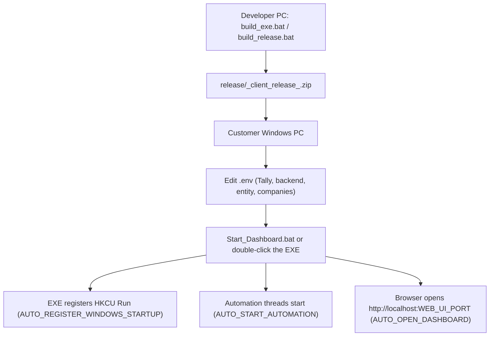

# Deployment

How the middleware apps are built, shipped and run at customer sites. It is drawn from the build scripts, `README_CLIENT_SETUP.txt` files, `automation/README.md` and `dashboard.py` startup code.

## Deployment model

- **One app per customer site**, on a Windows PC that can reach the site's Tally (`TALLY_URL`; client notes say `localhost:9000`) and the CATalytics backend (`CATALYTICS_API_BASE`). It optionally needs the backend PostgreSQL as well (`POSTGRES_*`, for fill-station and verification fallbacks).
- Shipped as a **single PyInstaller EXE** (no Python needed on site), plus `.env` and helper `.bat` files, in a zip.
- The EXE runs the Flask dashboard **and** the automation threads in one process. No Windows service is installed. Persistence comes from a per-user **HKCU Run** registry entry, so it starts at user logon, not at boot (inferred: it does not run while nobody is logged in).

## Artefacts per app

| App | EXE | Release zip prefix | Run key name | Task Scheduler prefix |
|-----|-----|--------------------|--------------|-----------------------|
| CO_middleware | `co_middleware_dashboard.exe` | `co_middleware_client_release_` | `COMiddlewareDashboard` (script) / `ChennaiOxygenMiddlewareDashboard` (EXE default) | - (legacy task `TallyMiddlewareUI` for `tally_ui.exe`) |
| BHOX_Middleware | `bol_dashboard.exe` | `bol_client_release_` | `BOLMiddlewareDashboard` | `BOL_Gas_` |
| arasan_gas | `arasan_gas_dashboard.exe` | `arasan_gas_client_release_` | `ArasanGasMiddlewareDashboard` | `Arasan_Gas_` |
| bol_company | `bol_dashboard.exe` | `bol_client_release_` | `BOLMiddlewareDashboard` | `BOL_Gas_` |

**Warning:** BHOX and BOL build the same EXE name and use the same Run key and task names. Installing both on one PC would make them collide (inferred). Override `WINDOWS_STARTUP_APP_NAME` to avoid this.

## Build (developer machine)

| Step | Detail |
|------|--------|
| Prerequisites | Windows, `py` launcher, `pip install -r requirements.txt pyinstaller` |
| Build | `build_exe.bat` (CO also has `build_exe.ps1`). Runs PyInstaller with `--onefile --noconsole --add-data "templates;templates" --collect-all psycopg2` and hidden imports for every module. CO also bundles `.env.example` |
| Release | `build_release.bat` calls `build_exe.bat`, then creates `release\<prefix><stamp>\` containing the EXE, `.env.example`, `.env` (a copy of the example), `README_CLIENT_SETUP.txt`, `Start_Dashboard.bat`, `Install_AutoStart.bat`, `Remove_AutoStart.bat` and `logs\`, and zips it with PowerShell `Compress-Archive` |
| One-shot | `BUILD_AND_DEPLOY.bat` (build + package). `BUILD_V1.2.0.bat` / `QUICK_BUILD.bat` add v1.2.0 helper files, some of which are missing in BHOX/BOL |
| CO legacy | `package_release.bat` / `.ps1` packages the older multi-EXE set (`tally_ui.exe`, `tally_loop.exe`, `tally_sync*.exe`, `tally_fetch*.exe`, `tally_masters_loop.exe`, `tally_reset_sync.exe`); an already-built copy sits in `CO_middleware/release/package/` |

## Install at the customer site

1. Extract the zip to a folder (client notes give `C:\BHOX` / `C:\BOL` as examples).
2. Edit `.env`: entity (`ENTITY_NAME`, `ENTITY_ID`), backend (`CATALYTICS_API_BASE` / CO `CATALYTICS_API_BASE_URL`, `CATALYTICS_API_KEY`), Tally (`TALLY_URL`, `TALLY_COMPANY_1..4`, `TALLY_COMPANY_ACTIVE`; CO `TALLY_COMPANY`), fill station defaults, `POSTGRES_*` if used. CO writes a default `.env` itself if none exists.
3. Make sure the Tally XML/HTTP interface is enabled on the configured port and the company is open in Tally.
4. Run `Start_Dashboard.bat` (CO sets `TALLY_ENV_PATH` to the local `.env` first) or double-click the EXE.
5. Optional: `Install_AutoStart.bat` (manual Run-key fallback; CO also sets the user env var `TALLY_ENV_PATH`). `Remove_AutoStart.bat` undoes it.
6. CO only, if the dashboard must be reachable from other PCs: `allow_firewall.bat` (admin) adds inbound rules for `WEB_UI_PORT` and the EXE. The CO `.env.example` already binds `WEB_UI_HOST=0.0.0.0`.

On first run the SQLite DB and `logs\` folder are created next to the EXE.

## Runtime behaviour when frozen

| Setting | Code default as EXE | Code default from source | Value in shipped `.env.example` (copied to `.env`) |
|---------|---------------------|--------------------------|----------------------------------------------------|
| `AUTO_START_AUTOMATION` | true | false | **false** (all four), so automation must be started from the dashboard or the value edited, despite client notes saying it auto-starts |
| `AUTO_OPEN_DASHBOARD` | true | false | true |
| `DASHBOARD_DEBUG` | false | true | false |
| `AUTO_REGISTER_WINDOWS_STARTUP` | false | ignored when not frozen | true |
| `WEB_UI_HOST` | `localhost` (multi-company) | same | `localhost` (multi-company), `0.0.0.0` (CO) |
| `TOGGLE_EXISTING_INSTANCE_ON_LAUNCH` (CO) | true: a second launch closes the running instance | false | true |

## Alternative schedulers (`automation/` folder, multi-company apps)

The in-process threads are the default. The `automation/` scripts run the Python sources with `py` instead (they need Python on the site PC):

| Option | Scripts | Behaviour |
|--------|---------|-----------|
| Console loops | `start_all_services.bat` / `stop_all_services.bat` | Checks Tally `localhost:9000` and backend `localhost:8000` with curl, then starts `continuous_fetch_invoices.bat` and `continuous_sync.bat` (30 s loops) minimized |
| Task Scheduler | `install_task_scheduler.bat` / `uninstall_task_scheduler.bat` (admin) | `schtasks /rl highest`: master data every 10 min; invoice fetch and sync each as two per-minute tasks offset by 30 s |
| Monitoring | `monitor_status.bat`, `view_logs.bat` | Status and log viewers |

Do not run these at the same time as the EXE's automation threads (inferred: both would hit Tally and the backend).

## Operations

| Task | How |
|------|-----|
| Check status | Dashboard: Connection Status, Automation Controls, System Diagnostics |
| Force fetch / sync | Dashboard Manual Actions (`/api/trigger/*`, `/api/fetch/now`, `/api/sync/now`) |
| Retry failures | Dashboard bulk retry / mark-unsynced. CLI `reset_failed_invoices.py`; CO `reset_sync.py --reset-type products,customers,dc,all` |
| Logs | `logs\` next to the EXE: `dashboard_operations.log`, per-operation `*_fetch.log`, `*_sync.log`, `*_errors.log`, plus `LOG_FILE`. No rotation (inferred) |
| Change schedule | Edit `.env` (re-read each cycle via `reload_from_env`) or use the dashboard intervals control (saved in `automation_state.json`) |
| Stop | `Stop_Dashboard.bat` (`taskkill`), or the dashboard automation stop |
| Upgrade | Replace the EXE and keep `.env`, the `.sqlite` file and `logs\` (inferred from the release layout) |

## Security notes for site installs

- `.env` holds the API key and DB password in plain text. `CO_middleware/.env` and `arasan_gas/.env` are tracked in git despite `.gitignore` and should be removed from version control and rotated (not opened for this review).
- Built EXEs and release zips (`arasan_gas/dist`, `arasan_gas/release`, `CO_middleware/release`) are also committed. Whether they embed a `.env` was not checked.
- `../CO_MIDDLEWARE_COMPLETE_GUIDE.md` contains sample values that look like real hosts and a token prefix; review it before sharing.
- The dashboard has no login. Keep `WEB_UI_HOST=localhost` unless remote access is needed.
