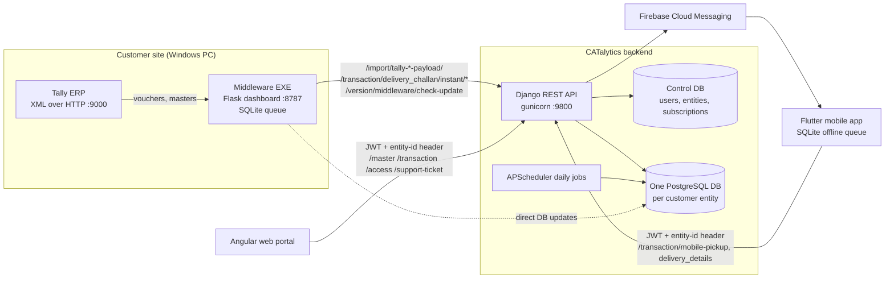

# CATalytics System Overview

This file is identical in all four CATalytics repos. It shows how the separately deployed projects fit together. Each repo's own `docs/` folder holds the detail.

Written 16-Oct-2026 from the code in each repo's `development` branch.

## The four projects

| Repo | Role | Stack | Docs entry point |
|---|---|---|---|
| `catalytics-india` | Web portal for office, admin and reports | Angular 18.2, TypeScript 5.5, served by nginx | `docs/ARCHITECTURE.md` |
| `catalytics-india-backend` | Central API and business logic, the only server the others talk to | Python 3.10, Django + DRF, SimpleJWT, gunicorn, PostgreSQL | `docs/ARCHITECTURE.md` |
| `catalytics-india-middleware` | Per-customer Tally sync agents installed at customer sites (CO, BHOX, Arasan Gas, BOL) | Python, Flask dashboard, SQLite queue, PyInstaller EXE | `docs/ARCHITECTURE.md` |
| `catalytics-mobile` | Driver and delivery app with offline sync | Flutter, Dart 3.7, sqflite, Firebase Messaging | `docs/ARCHITECTURE.md` |

## How they connect

## Key facts

- **The backend is the hub.** The web portal, mobile app and middleware never call each other directly. They share data only through the backend.
- **Multi-tenant by database.** Every request carries an `entity-id` header, and backend middleware routes it to that customer's own PostgreSQL database.
- **Auth.** The web and mobile apps log in at `api/auth/token` and get a JWT pair. The middleware mostly calls import endpoints that the backend allows anonymously, with an optional static service key.
- **Tally is the source of truth for customer sales data.** The middleware turns Tally vouchers into Delivery Challans in the backend. The backend can also pull from Tally directly using management commands.
- **Mobile works offline.** Deliveries and pickups queue in SQLite and post when the device reconnects.
- **Updates.** The middleware auto-updates its EXE through the backend version endpoint. The mobile app checks `version/check-updates` and self-updates over the air.

## Environments

| Environment | Web | API |
|---|---|---|
| Local dev | Angular dev server | `http://localhost:8000/` |
| UAT, from `development` branch | `uatapp.catalytics.us` | `uatappapi.catalytics.us` |
| POC | not confirmed | `pocapi.catalytics.us`, hard-coded in the mobile app |
| Production | not confirmed | not confirmed |

Deployment for the web portal and backend is Jenkins, with a manual approval step, then SSH to `ci/deploy.sh`. Middleware is installed by hand at each customer site.

## Cross-repo issues found while documenting

These were raised in the individual docs. They are listed here because they affect more than one repo.

1. **Secrets are tracked in git.** The backend tracks `.env` and `firebase_service_account.json`. The middleware tracks `CO_middleware/.env` and `arasan_gas/.env`. The Angular environment files ship `CRYPTO_KEY`, `SECRET_KEY` and `GMAPS_API_KEY` in the JS bundle. Remove these files from version control and rotate the keys.
2. **Backend safety switches are off by default.** `API_AUTH_ENFORCED` and `ENTITY_ID_ENFORCE_OWNERSHIP` default to off. That lets unauthenticated calls through and lets a user switch tenants by changing the `entity-id` header.
3. **Base URLs are fixed at build time.** Angular uses environment files and Flutter hard-codes the POC URL, so pointing a build at another environment needs a code change.
4. **Build artefacts are committed.** The mobile `build/` folder and the Arasan Gas `build/`, `dist/` and release zip are in git.
5. **The theme parity check looks for the wrong folder.** `tools/check-token-parity.mjs` in the web repo expects a backend folder that is not there.
